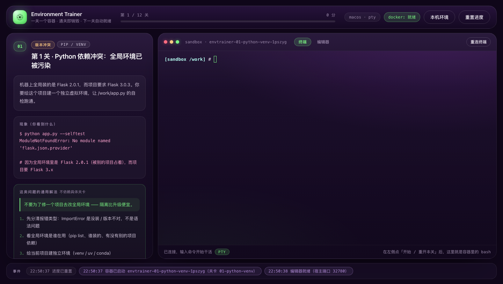

# Environment Trainer

把「开发环境构建 + 依赖冲突排查」做成闯关练习。每一关是一个坏掉的 Docker 容器，学员在浏览器终端里修复，
判题通过后容器自动销毁、拉起下一关。



15 关，覆盖 pip / uv / npm / go mod / Maven / apt / git / HTTP 代理 / VS Code 配置。

## 快速开始

```bash
python start.py            # 自检 + 启动，默认 http://127.0.0.1:8181
python start.py --check    # 只做环境自检，不启动
python start.py --port 9000
```

要求：**Python 3.9+**、**Docker 守护进程在跑**。后端零第三方依赖。

| 平台 | 启动命令 |
| --- | --- |
| macOS | `./run.sh` |
| Linux | `./run.sh` |
| Windows | `run.bat`，或 PowerShell `.\\run.ps1` |

## 镜像源（自动选最快）

首次构建镜像前会探测 apt / pip / npm / go 几个镜像站的延迟，挑最快的写进 `.mirrors.json`，
构建时通过 `--build-arg` 注入，容器里的 `sources.list`、`pip.conf`、`.npmrc` 也会跟着换。

```bash
python start.py --mirrors     # 重新探测（7 天缓存，可随时强制刷新）
python tools/pick_mirror.py   # 只看探测结果
python start.py --check       # 自检时会显示当前用的是哪家
```

实测这台机器上选出来的结果：

```
apt   aliyun=143ms  huawei=161ms  ustc=190ms  tuna=250ms  official=260ms
pip   aliyun=158ms  ustc=195ms    tuna=270ms  official=353ms
npm   npmmirror=245ms             official=434ms
go    goproxy.cn=138ms            official=472ms
```

不想要镜像源就删掉 `.mirrors.json`，构建会退回官方源（Dockerfile 里的 ARG 默认为空）。

## 关卡

| # | 关卡 | 生态 | 要点 |
| --- | --- | --- | --- |
| 1 | Python 依赖冲突 | pip / venv | 先分清 ImportError 是没装还是版本不对 |
| 2 | 搬家搬坏的 venv | pip / venv | 环境目录不可搬运，要交清单 |
| 3 | pip 解析死锁 | pip | 读 `ResolutionImpossible`，只动一边 |
| 4 | glibc 版本太老 | 编译 / 链接 | `ldd --version` vs `objdump -T` |
| 5 | 下错架构的二进制 | 编译 / 链接 | `uname -m` + `readelf -h` |
| 6 | GCC 13 不认 C++23 | apt / gcc | 装新工具链并让构建真的用上 |
| 7 | 两个 node，PATH 指错 | node / PATH | `which -a` / `type -a` / `echo $PATH` |
| 8 | npm peer 冲突 | npm | `ERESOLVE` 的 Found / Could not resolve 两行 |
| 9 | go.sum 缺条目 | go mod | `missing go.sum entry` 怎么补 |
| 10 | Maven 依赖收敛 | Maven | `dependency:tree -Dverbose` + `dependencyManagement` |
| 11 | apt 源漏组件字段 | apt / dpkg | `Malformed entry (Component)` |
| 12 | uv lock 过期 | uv | `--frozen` 为什么拒绝、lock 要一起提交 |
| 13 | 只能通过代理出网 | HTTP 代理 | 分清 DNS / 路由 / 代理三种失败（**可跳过**） |
| 14 | Git：身份 / 冲突 / 误提交 | git | `.gitignore` 只对未跟踪文件生效 |
| 15 | VS Code 工作区配置 | VS Code | `settings/launch/tasks/extensions` 四件套 |

第 1、8、9、10、14、15 关带内嵌编辑器（code-server），右侧可切「终端 / 编辑器」。

第 13 关需要容器能访问 `pypi.org`，受限网络下可以跳过（不计分），其余关卡不可跳过。

## 目录结构

```
start.py                 三平台启动器（自检 / 选端口 / 开浏览器）
run.sh run.bat run.ps1   薄封装
server/
  app.py                 HTTP API + WebSocket 终端
  term.py                终端后端：PosixPTY / WinConPTY / 管道兜底，自动降级
  proxy.py wsclient.py   代理到容器内服务的 HTTP / WS 实现
  hostcheck.py           宿主机体检（本机环境面板）
  docker_ctl.py          docker CLI 封装（容器 / 网络 / 端口映射）
  levels.py              关卡加载、判题解析、会话与进度
  ws.py                  RFC6455 WebSocket 服务端
  platform_util.py       平台判定、docker 查找、子进程 UTF-8
web/                     前端（xterm.js 已本地化到 vendor/）
levels/
  01-python-venv/ ... 15-vscode-config/
  _toolchain/code-server/  共享的编辑器镜像层
    level.json           关卡元数据（前端完全由它驱动）
    Dockerfile           环境
    task/                拷进容器的工作文件
    judge.sh             判题脚本
docs/                    截图
```

进度与会话状态存在 `.state/state.json`（已 gitignore）。

## 加一关

1. `mkdir levels/16-xxx`，放三个东西：
   - `Dockerfile`：把环境做成坏掉的样子，`CMD ["sleep","infinity"]`
   - `task/`：拷进容器 `/work` 的文件
   - `judge.sh`：判题脚本，只用容器里已有的工具
2. 写 `level.json`：

```json
{
  "id": "16-xxx",
  "order": 16,
  "title": "第 16 关 · ……",
  "summary": "现场是什么样、要达成什么",
  "category": "version",
  "category_label": "版本冲突",
  "tool": "pip",
  "tool_label": "pip",
  "symptom": "$ make\nfatal error: ...",
  "diagnose": ["uname -m", "file ./xxx"],
  "objectives": ["目标 1", "目标 2"],
  "hints": ["提示 1"],
  "method": { "rule": "一句话法则", "steps": ["步骤 1", "步骤 2"] },
  "solution": ["# 参考解法", "make build"],
  "platform_notes": { "macos": "…", "windows": "…", "linux": "…" },
  "points": 100,
  "workdir": "/work",
  "judge_timeout": 120,
  "image": "envtrainer/level-16-xxx:latest"
}
```

可选字段：`vscode`（内嵌编辑器）、`skippable` + `skip_reason`（允许跳过）、`sidecars`（附属容器）。

3. 刷新页面即可。镜像不存在时第一次「开始」会自动 `docker build`。

判题脚本改完要重建镜像：`docker build -t <image> levels/<id>`。

## 判题协议

`judge.sh` 用 stdout 表达结果，一行一项：

```
CHECK|ok|虚拟环境|.venv/bin/python 存在
CHECK|fail|Flask 版本|当前 2.0.1，需要 3.0.3
RESULT|fail
```

- `CHECK|ok|fail|名称|细节`：前端渲染成 ✓/✗ 清单
- `RESULT|pass|fail`：最终判定；不写这行时退回用退出码
- 通过后容器立即销毁，进度 +1

## 终端

| 平台 / 条件 | 后端 | 体验 |
| --- | --- | --- |
| macOS / Linux | `pty.openpty()` | 完整 TTY |
| Windows 10 1809+ | ConPTY（ctypes 直调） | 完整 TTY |
| 更早的 Windows / 失败 | `docker exec -i` + 管道 | 命令可跑，全屏程序不可用 |

页面底部显示当前模式。强制指定：`ENVTRAINER_TERM=pipe python start.py`。

## 常见问题

| 现象 | 处理 |
| --- | --- |
| 端口被占 | `start.py` 会自动往后找，看控制台输出的地址 |
| 找不到 docker | 装 OrbStack / Docker Desktop / docker-ce |
| `permission denied docker.sock` | `sudo usermod -aG docker $USER` 后重新登录 |
| Windows 上显示「兼容模式」 | 系统没有 ConPTY，需要 Win10 1809+ |
| 服务在容器 / 远程机器上，本机打不开 | 默认监听 `127.0.0.1`，容器里要 `--host 0.0.0.0` |
| 判题脚本改完不生效 | 重建镜像 |
| 第一次点开始很慢 | 在 build 镜像，之后有缓存 |
